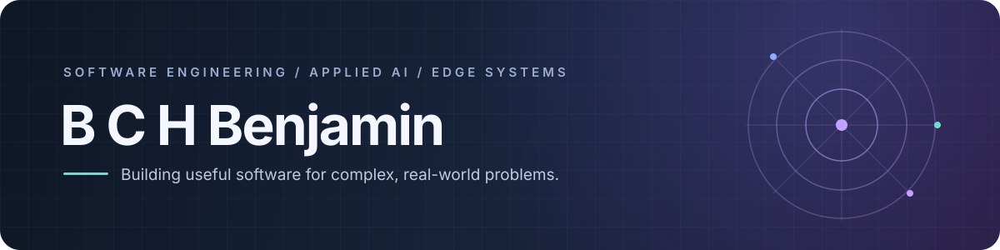

 

---

## About

I'm a Computer Science & Engineering student interested in the space between **intelligent systems and thoughtful product engineering**. I work across full-stack applications, applied machine learning, data workflows and edge devices — with a bias toward practical things that can be tested, shipped and improved.

I enjoy taking a problem from its constraints through architecture and implementation, without losing sight of performance, maintainability or the people using the result.

<table>
<tr>
<td width="50%" valign="top">

### What I like building

- **Applied AI** — useful ML and language technologies
- **Edge systems** — capable software within real hardware constraints
- **Product engineering** — coherent interfaces and dependable backends
- **Developer tooling** — automation and infrastructure that remove friction

</td>
<td width="50%" valign="top">

### A few milestones

- ♟️ U-19 Bengaluru Urban District Boys' runner-up · 2024
- ♟️ Chess.com Ambassador
- 🎓 9.00 SGPA · Semester 4
- ⚙️ OpenFOAM engineering internship · FOSSEE

</td>
</tr>
</table>

## Selected work

<table>
<tr>
<td width="50%" valign="top">

<h3>AWARESPAN</h3>

EDGE AI · SAFETY SYSTEMS

An AI-powered safety device exploring local threat detection and connected alerts on edge hardware.

`Python` `Raspberry Pi` `Computer Vision`

<a href="https://github.com/awarespan/node-core-processing">Explore public repository ↗</a>

</td>
<td width="50%" valign="top">

<h3>Siddhi</h3>

FULL-STACK · PRODUCT ENGINEERING

A role-aware platform with dedicated student and guardian experiences, reports and backend integration.

`Next.js` `TypeScript` `React`

<a href="https://github.com/bchbenjamin/siddhi">Explore public repository ↗</a>

</td>
</tr>
<tr>
<td width="50%" valign="top">

<h3>AI-IDA</h3>

NLP · INTELLIGENT DATA ANALYTICS

An academic detection pipeline for suspicious internship and job opportunities using message metadata and language analysis.

`Python` `NLP` `Classification`

<a href="https://bchbenjamin.in/projects/ai-ida">Project overview ↗</a>

</td>
<td width="50%" valign="top">

<h3>ClipZ</h3>

PYTHON · DESKTOP SOFTWARE

A lightweight desktop video editor designed to stay usable on low-spec PCs, with a deliberately small dependency footprint.

`Python` `Tkinter` `Desktop UX`

<a href="https://bchbenjamin.in/projects/clipz">Project overview ↗</a>

</td>
</tr>
</table>

<a href="https://bchbenjamin.in/projects">More projects and details on my portfolio ↗</a>

## Tools I work with

| Focus | Technologies |
| --- | --- |
| **Languages** | Java · Python · TypeScript · JavaScript · SQL |
| **Web & backend** | React · Next.js · Spring Boot · REST APIs · PostgreSQL |
| **AI & data** | Machine Learning · NLP · Data Analytics |
| **Systems** | Linux · Raspberry Pi · Docker · Git · Edge Computing |

## Recent public activity

<!-- PROFILE_ACTIVITY_START -->
- [agent](https://github.com/bchbenjamin/agent)
- [siddhi](https://github.com/bchbenjamin/siddhi)
- [capstone-CP002-benjamin-yogeetha](https://github.com/bchbenjamin/capstone-CP002-benjamin-yogeetha)
- [SIP](https://github.com/bchbenjamin/SIP)
- [BAINB501](https://github.com/bchbenjamin/BAINB501)
<!-- PROFILE_ACTIVITY_END -->

---

### Let's build something useful.

For engineering discussions, collaboration or a worthwhile problem to solve:

[**bchbenjamin.in**](https://bchbenjamin.in) · [**me@bchbenjamin.in**](mailto:me@bchbenjamin.in)

Thoughtfully built. Constantly iterating.

About this repository

This is the special GitHub profile repository for **bchbenjamin** and the source code for [bchbenjamin.in](https://bchbenjamin.in). The portfolio platform is built with Next.js, Java / Spring Boot and PostgreSQL. Its engineering documentation, architecture notes and development instructions live in the repository's `docs/` directory.

